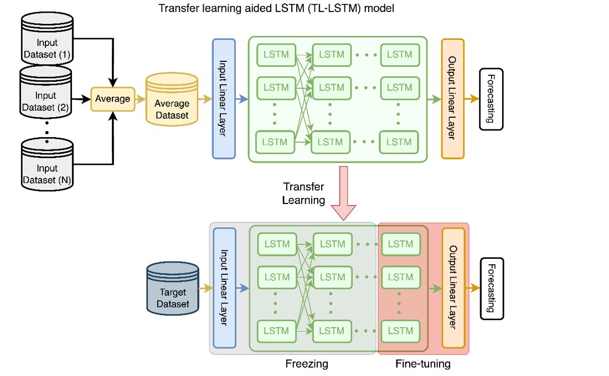
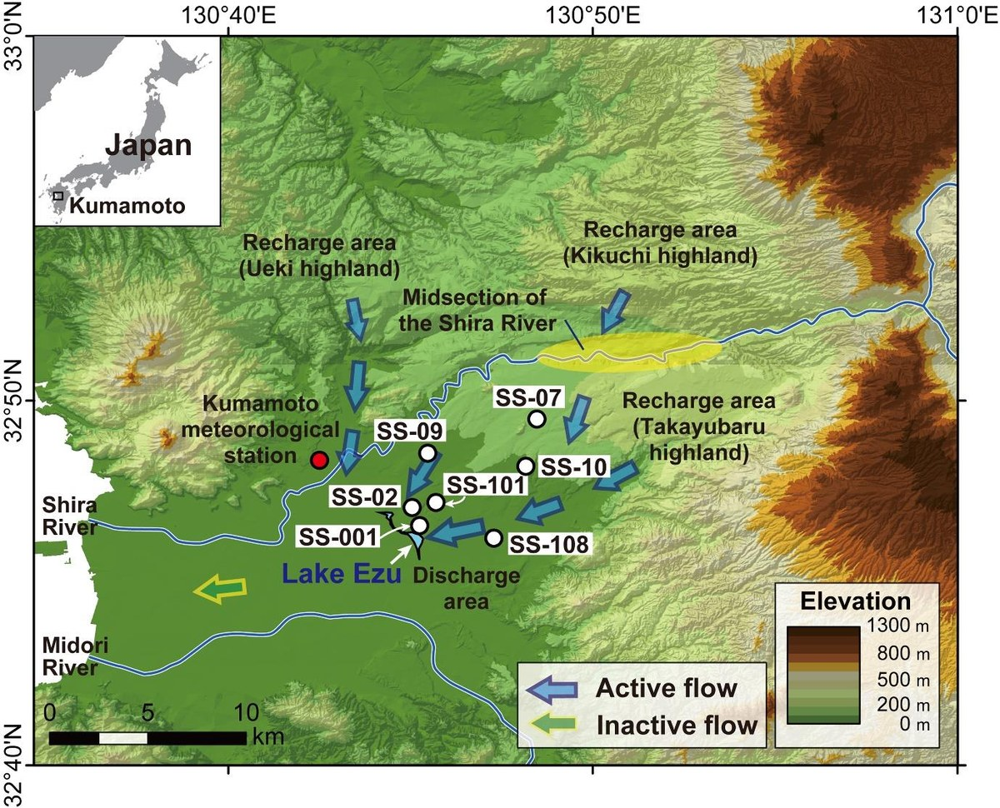
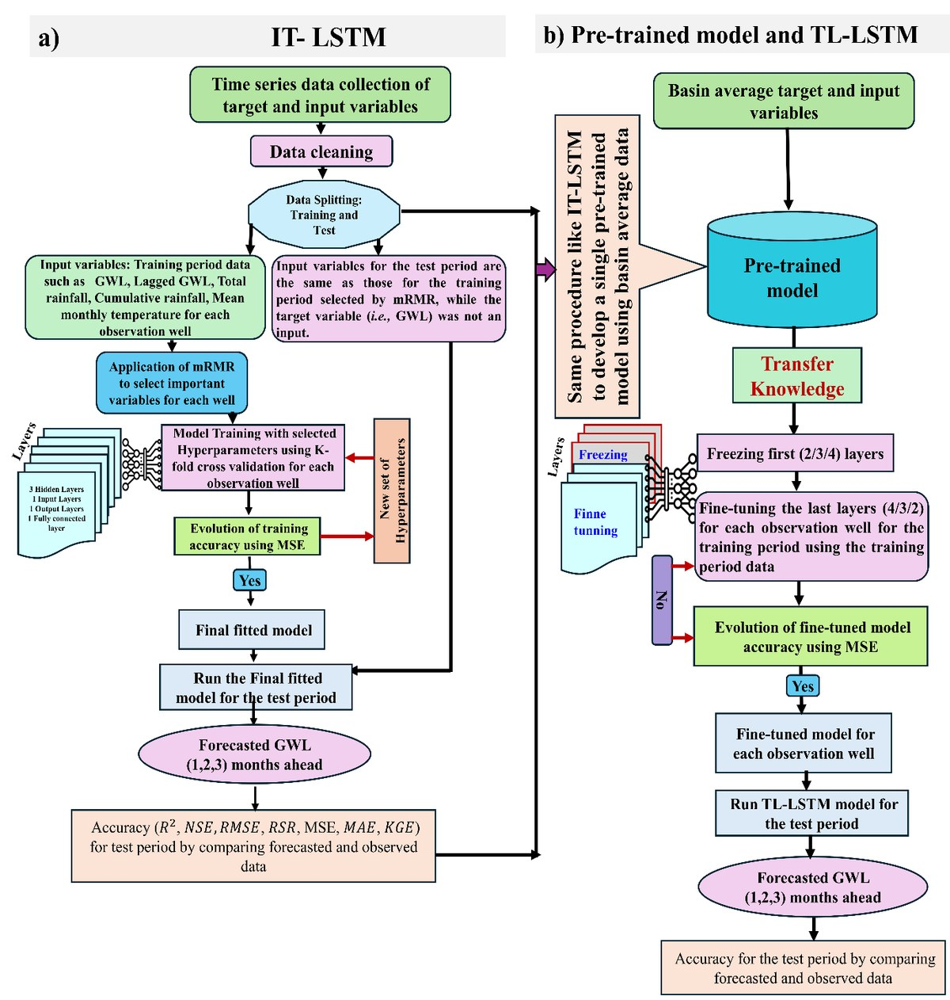
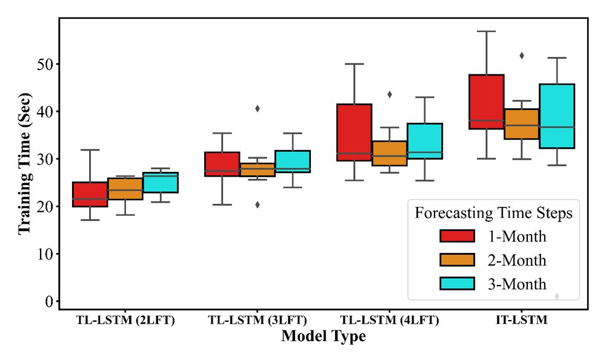

# TL-LSTM: Basin-wide Groundwater Level Forecasting with Transfer Learning

[](https://doi.org/10.1080/02626667.2025.2530120)
[](https://doi.org/10.1080/02626667.2025.2530120)


Code for

> **Basin-wide groundwater level forecasting in Kumamoto, Japan: integrating transfer learning with Long Short-Term Memory network**<br>
> A. T. M. Sakiur Rahman, **Shahriar M. Sakib**, Md Kaykobad Reza, Amiya Basak, Khandaker Nusaiba Hafiz, Md Shazid Islam, Takahiro Hosono<br>
> *Hydrological Sciences Journal* 70(14), 2590–2608, 2025 · [paper](https://doi.org/10.1080/02626667.2025.2530120)

<p align="center">
  
</p>
<p align="center"><sub><b>TL-LSTM.</b> A single LSTM is pre-trained on the basin-average groundwater series. For each observation well, its early layers are frozen and only the last few layers are fine-tuned. From Figure 2d in the paper.</sub></p>

## Summary

Deep learning models forecast groundwater levels (GWL) well, but each observation well usually gets its own model, trained and tuned from scratch. That is manageable for a handful of wells and impractical for a whole basin. We ask whether **one** model can serve every well:

- **IT-LSTM** (baseline): an independently trained, individually tuned LSTM for each well.
- **Pre-trained model**: a single LSTM trained on the basin-average GWL series.
- **TL-LSTM**: the pre-trained model is transferred to each well. The input layer and early LSTM layers stay frozen, and only the last 2, 3 or 4 layers are fine-tuned (2LFT / 3LFT / 4LFT).

Forecasts are made 1, 2 and 3 months ahead. The transferred models come close to the per-well baselines while removing most of the per-well training and tuning effort.

## Study area and data

The study covers seven observation wells (SS-001, SS-02, SS-07, SS-09, SS-10, SS-101, SS-108) in the Kumamoto Groundwater Basin in southern Japan. Each has monthly GWL records for 1980–2017. Inputs are lagged GWL plus lagged monthly rainfall, cumulative rainfall and mean air temperature (up to 12 months). Inputs are chosen with mutual-information-based feature selection, and the data are split 85/15 into training and test sets.

<p align="center">
  
</p>
<p align="center"><sub>Kumamoto Groundwater Basin, observation wells and regional flow paths (Fig. 1).</sub></p>

The GWL records come from the Government Office of Kumamoto City and the Kumamoto City Waterworks and Sewerage Bureau, and **are not redistributed here**. The notebooks expect one CSV per well at `Data/SS.<well> from 1981-2017.csv`.

## Results

Basin-average test accuracy over the seven wells (Tables 2–3 in the paper):

| Horizon | IT-LSTM R² | IT-LSTM NSE | TL-LSTM (3LFT) R² | TL-LSTM (3LFT) NSE |
|---|--:|--:|--:|--:|
| 1 month | 0.93 | 0.92 | 0.92 | 0.91 |
| 2 months | 0.86 | 0.86 | 0.85 | 0.82 |
| 3 months | 0.78 | 0.77 | 0.74 | 0.72 |

- **Accuracy is close to the per-well models.** Fine-tuning the last three layers gives accuracy almost equal to IT-LSTM at the 1- and 2-month horizons. The gap widens slightly at 3 months.
- **Development time drops substantially.** Building the TL-LSTM models for all seven wells takes about one-sixth of the time needed for the IT-LSTM models. Most of the savings come from skipping per-well hyperparameter calibration. Pure training time per well also falls, from 40.2 s (IT-LSTM) to 33.8 s, 28.2 s and 23.7 s for 4LFT, 3LFT and 2LFT on a laptop CPU (Fig. 9).
- **One limitation stands out.** TL-LSTM is weakest at SS-07, the well in hilly terrain, where local dynamics differ most from the basin average.

<table>
<tr>
<td width="55%"></td>
<td width="45%"></td>
</tr>
<tr>
<td><sub>Workflow for (a) IT-LSTM and (b) the pre-trained model and TL-LSTM (Fig. 3).</sub></td>
<td><sub>Per-well training time for TL-LSTM with 2, 3 or 4 fine-tuned layers vs. IT-LSTM, by forecast horizon (Fig. 9). This excludes IT-LSTM's per-well hyperparameter search.</sub></td>
</tr>
</table>

## Repository structure

```
├── Code_009.ipynb            # IT-LSTM: independently trained model for well SS-09
│                             #   (MI feature selection, training, 1/2/3-month forecasts, metrics)
├── Code_Avg.ipynb            # Pre-trained model on the basin-average series,
│                             #   evaluated on each of the seven wells at 1/2/3-month horizons
├── domain_adaptation.ipynb   # TL-LSTM: load the pre-trained model, freeze early layers,
│                             #   fine-tune the last layers on a target well
└── assets/                   # figures reproduced from the paper
```

A cleaned single-notebook version of the IT-LSTM pipeline for well SS-001 is in the companion repository [groundwater-level-GWL-forecasting](https://github.com/Shahriarmsakib/groundwater-level-GWL-forecasting).

## Setup

The notebooks were written for Google Colab and mount Google Drive in their first cell. To run them locally, remove that cell and set the paths.

```bash
pip install tensorflow scikit-learn pandas numpy matplotlib HydroErr SeqMetrics
```

Pre-trained model hyperparameters (Table 1): 3 LSTM layers with 128 units, a 64-unit dense layer, dropout 0.15, LeakyReLU (α = 0.25), Adam (lr 1e-3), batch size 16, up to 200 epochs with early-stopping patience 20.

Run the notebooks in this order:

1. `Code_Avg.ipynb` trains and saves the pre-trained models (`NewSavedModels/avg_{1,2,3}_month.keras`).
2. `domain_adaptation.ipynb` fine-tunes one of them for a target well.
3. `Code_009.ipynb` gives the IT-LSTM baseline for comparison.

## Citation

```bibtex
@article{rahman2025basin,
  title   = {Basin-wide groundwater level forecasting in Kumamoto, Japan: integrating
             transfer learning with Long Short-Term Memory Network},
  author  = {Rahman, A. T. M. Sakiur and Sakib, Shahriar M. and Reza, Md Kaykobad and
             Basak, Amiya and Hafiz, Khandaker Nusaiba and Islam, Md Shazid and Hosono, Takahiro},
  journal = {Hydrological Sciences Journal},
  volume  = {70},
  number  = {14},
  pages   = {2590--2608},
  year    = {2025},
  doi     = {10.1080/02626667.2025.2530120}
}
```

<sub>Figures are reproduced from the paper for illustration; please cite the paper if you use them.</sub>
